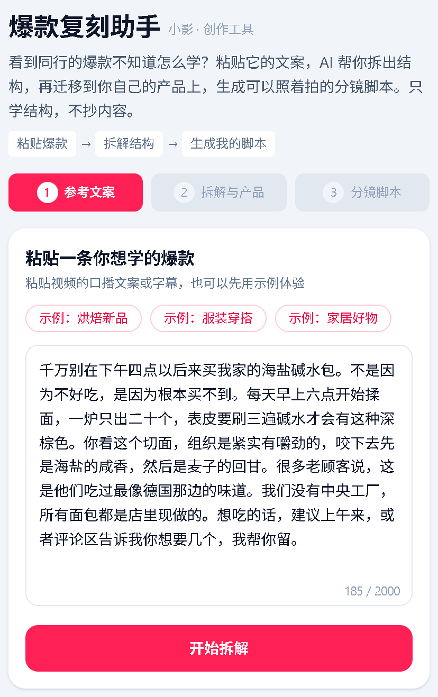
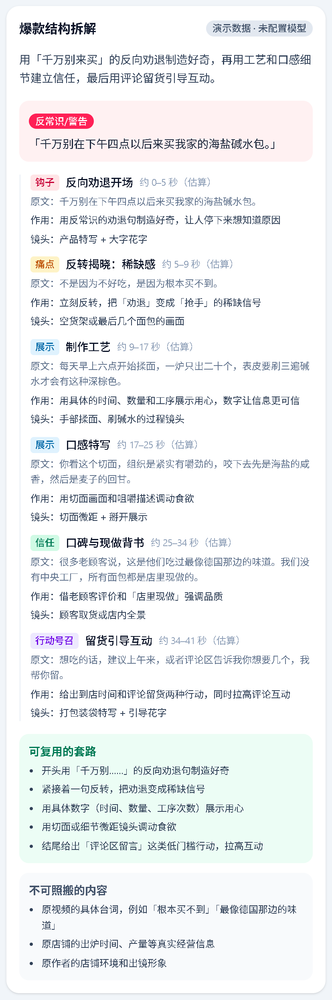
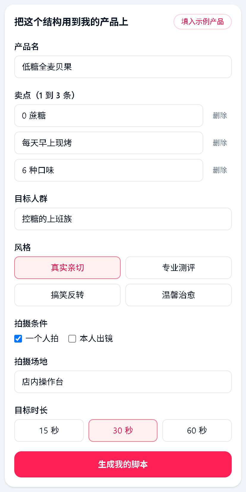
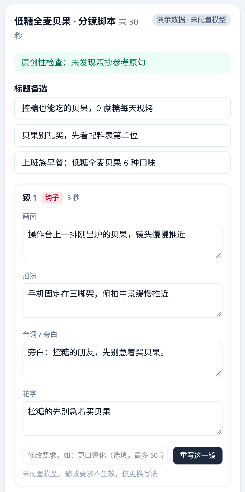
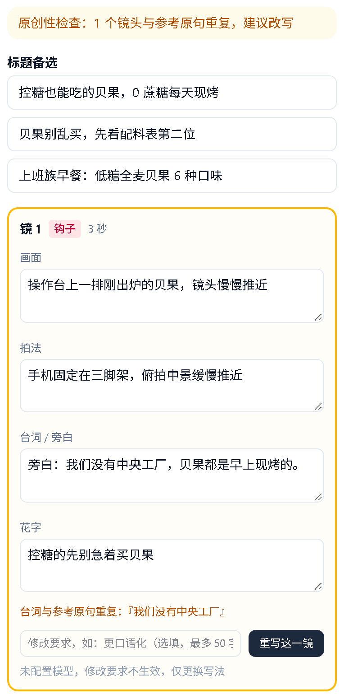

# 爆款复刻助手 · 产品说明文档

> 小影 AI 产品经理笔试 · 方向：AI 与内容创作
>
> Demo 代码仓库：https://github.com/yyk230/viral-remix-assistant

### 亮点速览

- **切中创作链路上游的空白**：剪辑工具解决「怎么剪」，这个功能解决「拍什么、怎么拍」，与小影的剪辑能力天然衔接。
- **只学结构、不抄内容，并且可验证**：拆解爆款的钩子、节奏和镜头顺序，迁移到用户自己的产品上；用确定性规则实时检查台词有没有照抄原句，而不是只靠 prompt 约束。
- **生成的脚本用户真的拍得出来**：生成时就考虑「一个人拍、不出镜」等真实拍摄条件。
- **完整可运行**：三步流程走通，不配置任何 Key 也能完整体验；配置模型 Key 后自动切换为真实大模型，调用失败时自动降级，不会让用户卡住。

---

## 1. 一句话概括产品

**面向自己用手机拍短视频的小店主：刷到爆款、想给自己的产品拍一条类似视频时，粘贴爆款文案，AI 拆解出它的结构并迁移到自己的产品上，生成一份能直接照着拍、又不照抄原句的分镜脚本。它解决的是「看得出别人火，却说不清火在哪；想模仿，又怕雷同和侵权」。**

产品定位为小影 App 内的一个创作功能，Demo 以手机尺寸的 Web 页面呈现。

---

## 2. 用户场景

### 目标用户

小林，31 岁，在二线城市开了一家烘焙工作室，一个人经营。店里的新品靠她自己用手机拍抖音来宣传，没有团队，也不想出镜。

### 使用场景

周二下午，小林刷到一条同城面包店的视频，开头一句「千万别在下午四点以后来买我家的碱水包」，点赞好几万。她刚做出一款低糖全麦贝果，也想拍一条，但不知道从哪下手。

### 当前痛点

- **说不清别人为什么火**：她能感觉到开头那句话很抓人，但讲不出背后的套路——是反向劝退？是稀缺感？后面为什么要讲揉面的细节？
- **照着拍会翻车**：直接套用原句，换成自己的产品后很别扭；而且同城同行一眼就能看出来，也有侵权风险。
- **拍摄条件受限**：一个人拍、不出镜，很多爆款的拍法（跟拍、真人口播）她做不到。

### 当前的解决方式，以及为什么不够好

| 现有做法 | 问题 |
| --- | --- |
| 反复刷同行视频，凭感觉模仿 | 耗时，学到的是表面的台词，学不到结构 |
| 套用剪辑 App 的模板 | 模板解决的是「怎么剪」，不解决「拍什么」 |
| 让通用大模型写脚本 | 写出来的脚本不贴合爆款的结构，也不考虑「一个人拍、不出镜」的条件，需要反复调教 prompt |

---

## 3. 产品原型（Demo）

运行方式见项目根目录的 [README.md](../README.md)。最快路径：`npm install` → `npm run dev` → 打开 http://localhost:3000 → 选一个示例 → 开始拆解 → 填入示例产品 → 生成我的脚本。

### 用户流程

| 环节 | Demo 中的实现 |
| --- | --- |
| 用户如何进入 | 页头一句话说明价值，并用「粘贴爆款 → 拆解结构 → 生成我的脚本」三步示意，下方直接是步骤 1 |
| 用户如何开始 | 点 3 个内置示例之一（烘焙新品、服装穿搭、家居好物），或粘贴自己的文案（30 到 2000 字）；只粘贴链接时提示暂不支持 |
| 产品如何处理 | 拆解出钩子类型和钩子原句、分段时间轴（每段的角色、估算秒数、原文、作用、镜头类型），以及「可复用的套路」和「不可照搬的内容」 |
| 用户补充信息 | 填写产品名、1 到 3 条卖点、目标人群、风格、拍摄条件（是否一个人拍、是否出镜、场地）、目标时长（15、30、60 秒），也可以一键填入示例产品 |
| 产品输出什么 | 3 个标题备选、分镜卡片（镜号、时长、对应的结构段落、画面、拍法、台词或旁白、花字）、拍摄清单、原创性检查结果 |
| 用户如何修改 | 卡片里每个字段都可以直接编辑；每一镜可以附带修改要求单独重写；返回上一步修改产品或时长后重新生成（会提示覆盖手动修改） |
| 用户如何拿走结果 | 复制脚本或下载 `.md` 文件 |

### 核心设计：只学结构，不抄内容

- 拆解结果把「可复用的套路」（例如「开头用反向劝退句制造好奇」）和「不可照搬的内容」（原台词、原作者人设、独家素材）分开列出。
- 生成脚本时，prompt 要求只迁移结构、禁止复用参考文案中连续 8 个字以上的原句。
- 这一点不只依赖 prompt：页面上有一个**确定性的原创性检查**，逐镜计算台词和花字与参考文案的最长公共子串，达到 8 个字就把这张卡片标黄并显示重复片段。用户编辑后实时重新计算。

### 截图

以下截图均在未配置模型 Key 的情况下截取（即评审本地运行时看到的效果），使用示例 1「烘焙新品」和示例产品「低糖全麦贝果」。

**步骤 1：粘贴参考文案**（点击示例按钮即可填入）

**步骤 2：爆款结构拆解**（钩子类型、分段时间轴、可复用的套路、不可照搬的内容）

**步骤 2：填写我的产品**（产品、卖点、人群、风格、拍摄条件、时长）

**步骤 3：分镜脚本**（标题备选、逐镜可编辑的分镜卡片、原创性检查通过）

**原创性警告**：把参考文案中的「我们没有中央工厂」粘进镜 1 的台词后，卡片立即标黄，并显示重复片段

### Demo 范围与取舍

Demo 的目标是验证核心假设：「结构拆解 + 迁移」能否产出用户拍得出来、又不照抄的脚本。与这个假设无关的能力暂不实现：

| 范围 | 当前做法 | 取舍理由 |
| --- | --- | --- |
| 输入方式 | 粘贴口播文案或字幕，暂不解析视频链接 | 解析链接需要视频下载、ASR 和视觉理解，属于工程投入，不影响核心假设的验证；已列入后续路线 |
| 未配置模型 Key | 「内置示例 + 示例产品 + 30 秒」返回预置的高质量示例结果，其他组合由规则引擎生成，用于演示完整流程 | 保证评审不配置 Key 也能体验完整流程；真实的生成质量以接入大模型后为准 |
| 单镜重写 | 接入模型后按修改要求重写；未配置模型时只更换写法 | 演示模式没有语言理解能力，不假装响应修改要求 |
| 原创性检查 | 检查台词和花字 | 台词和花字是最容易照抄、也最容易被认出的部分；画面和拍法属于结构层面，本来就允许借鉴 |
| 数据保存 | 不做账号和持久化，刷新后数据清空 | Demo 不涉及账号体系，聚焦单次创作流程 |

---

## 4. 产品判断

### 为什么选这个方向

- **需求真实且高频**：「看到爆款 → 想拍同款」是短视频创作里最常见的起点，小商家尤其依赖模仿来学习。
- **卡点在剪辑之前**：剪辑工具已经很成熟，但「拍什么、怎么拍」仍然靠个人经验。这一步做好了，能直接带动后续的剪辑和发布，与小影的剪辑能力形成上下游。
- **大模型擅长这件事**：结构拆解和风格迁移是大模型的强项，而且结果可以用规则做校验，落地风险可控。

### 差异化

1. **结构迁移，而不是内容生成**：不是凭空写一个脚本，而是以一条已经被验证过的爆款为骨架，迁移到用户自己的产品上。
2. **可验证的原创性**：用确定性规则检查有没有照抄原句，而不是只在 prompt 里要求。这同时降低了用户的侵权顾虑。
3. **贴合拍摄条件**：生成时就考虑「一个人拍、不出镜」等约束，输出的是用户真的能拍出来的脚本。

### 如果只能保留一个核心功能

保留**「结构拆解并迁移到自己的产品」**。

拆解单独存在只是一份分析报告，用户看完还是不知道怎么拍；编辑、重写、导出都是锦上添花。只有「拆解 + 迁移」合在一起，才把「我想拍类似的」直接变成「我知道明天怎么拍」，这是用户来用这个功能的根本原因。

### 如何衡量成功

- **北极星指标：脚本拍摄完成率**，即生成脚本后、实际按脚本拍完并导入剪辑的比例。它同时检验两件事：脚本是否真的有用、用户是否拍得出来，也直接衔接小影的剪辑环节。
- **辅助指标**：
  - **脚本采纳率**：生成后被复制、下载或进入拍摄的比例，衡量拆解和生成的质量。
  - **原创性检查通过率**：最终采用的脚本中没有照抄原句的比例，确保「只学结构」这一差异化真正成立。

### 最担心的失败原因

| 风险 | 表现 | 验证指标 |
| --- | --- | --- |
| 脚本雷同或照抄 | 同一条爆款被很多人复刻，出来的视频高度相似 | 原创性检查命中率；同一参考视频下不同用户脚本的相似度 |
| 用户拍不出来 | 脚本写得好，但镜头要求超出用户能力 | 生成后实际按脚本拍完并导入剪辑的比例 |
| 用一次就走 | 新鲜感过后没有持续价值 | 7 日、30 日复用率 |
| 效果不好 | 复刻出来的视频数据不理想 | 发布后播放量与用户自己历史视频的对比 |

### 后续路线

1. 通过 ASR 和视觉理解直接解析视频链接，省去手动粘贴文案。
2. 按平台（抖音、小红书）区分风格和节奏。
3. 脚本与小影的剪辑模板打通：按分镜自动生成剪辑工程，拍完即可一键成片。

---

## 5. 我最喜欢的产品或功能

### 我最喜欢的功能：剪映的「识别字幕 + 文本剪辑口播」

**它是什么**

剪映能把视频里的人声自动识别成带时间轴的字幕。更进一步，识别出的文字可以当作剪辑的入口：在文本里删掉一句话、一个语气词，对应的那段画面和声音也会一起被剪掉。软件还会自动标出停顿、「嗯」「那个」这类语气词，可以一键批量删除。

**它解决了什么用户问题**

口播是短视频里最常见的形式，而剪口播最费时间的两件事是：

1. **加字幕**：过去要边听边打字、逐句对齐时间轴，几分钟的视频要花不少时间。
2. **剪掉口误和停顿**：一条口播很少一次说好，中间会有停顿、语气词和说错重来的地方。在时间轴上靠听声音、看波形去找这些位置，既慢又容易漏。

这两件事技术含量不高，却又耗时又磨人，常常是新手放弃自己剪视频的原因。

**具体的使用场景**

以一位每周更新几条口播视频的知识类创作者为例。口播很少一次录好，常见的做法是一句话说错就停顿一下、重说一遍，所以原始素材里夹杂着大量停顿、语气词和重复的句子。

在传统的时间轴剪辑里，剪这样一条素材的大部分时间都花在来回拖动时间轴、听声音找「从哪里开始重说」，然后再逐句打字幕、对齐时间。

有了这个功能，流程变成：

1. 导入素材，识别字幕；
2. 一键删除停顿和语气词；
3. 在文字里把说错的那一遍整句删掉；
4. 检查一遍字幕的错别字。

整个过程更像是在改一篇文稿，而不是在做视频剪辑。

**为什么我喜欢它**

- **它改变了剪辑的操作对象**：从「时间轴上的波形」变成了「文字」。改文档几乎人人都会，而时间轴剪辑需要专门学习，这个转换大幅降低了剪辑的门槛。
- **它把 AI 用在了最痛的地方**：没有去做花哨的「一键成片」，而是解决口播创作者每天都会遇到的重复劳动，节省的时间是实实在在的。
- **结果可控**：AI 识别和标记，最终删不删由人决定。识别错了可以直接改字，不会出现「AI 自作主张、结果不能用」的情况。

**如果我是负责人，会怎么改进**

1. **把「重说」识别得更准**：口播里最常见的废片是「同一句话说了两遍」，而且第二遍往往换了措辞，字面上并不重复。可以通过语义相似度识别前后相邻、意思相同的句子，默认保留后一遍、标记前一遍待删，用户确认即可。
2. **按语义分段，并建议 B-roll 插入点**：长口播一镜到底容易单调。可以根据文本内容自动分段，在提到具体物品或场景的位置提示「这里可以插入一个特写镜头」，并关联素材库。
3. **与拍摄前的脚本打通**：如果拍摄前已经有脚本，识别字幕后可以与脚本逐句比对，自动定位漏说的句子和偏离脚本的部分。这也是本次 Demo「爆款复刻助手」想往后延伸的方向：从脚本到拍摄，再到剪辑，形成闭环。

---

## 6. AI 工具使用情况

### 使用了哪些工具

- Cursor 编辑器及其内置的大模型（对话、写代码、写文档）。

### 分工方式

我以产品经理的角色使用 AI：**我负责产品定义、关键决策和质量把关，AI 负责方案细化和执行。** 具体来说，AI 完成了以下工作：

- 根据笔试题目提出 4 个候选方向（小商家商品短视频生成、爆款结构拆解复刻、vlog 素材自动成片、口播智能粗剪），供我选择。
- 按我选定的方向编写实现方案，并按我的要求多轮审查方案、补充细节、修正问题。
- 按确认后的方案编写 Demo 代码和单元测试，在浏览器中走查流程，截取文档截图。
- 撰写本文档的初稿，整理 AI 使用记录。

### 哪些是我自己判断和决定的

- **方向**：从 4 个候选方向中选定「爆款结构拆解复刻」。
- **技术取舍**：决定采用「有 Key 时调用真实模型、没有或失败时退回演示数据」的方案，保证评审不配置 Key 也能完整体验。
- **交付方式**：决定只交代码，由评审在本地运行。
- **第 5 题的产品**：选定剪映的「识别字幕 + 文本剪辑口播」。
- **质量把关的节奏**：先出方案、不急着写代码，并多次要求 AI 审查方案，确认无误后才开始实现；实现完成后再要求 AI 逐条核对方案是否全部完成。

### 修改或否定了 AI 的哪些产出

- **否定了 AI 推荐的交付方式**：AI 推荐「代码 + 本地配置 Key 后录制演示视频」，我选择了只交代码。这个决定反过来要求 Demo 在不配置 Key 时也必须好用，因此方案中增加了「内置示例 + 示例产品」的预置高质量结果，并在 README 开头写明最快体验路径。
- **没有采纳 AI 的第一版方案**：我要求 AI 从「是否合理、是否过度设计、是否写得足够细、能否避免实现偏差」几个角度连续审查了 3 轮，据此做了以下修改：
  - 删掉了多余的功能：独立首页、平台选择（抖音 / 小红书）、「导入小影剪辑」概念按钮。
  - 合并了步骤：拆解结果和产品表单放在同一屏，四步改为三步。
  - 增加了可验证的原创性检查：「只学结构、不抄内容」原本只写在 prompt 里，改为用最长公共子串规则在页面上实时检查。
  - 修正了会导致 bug 的设计：只有一句话的文案会让规则拆解出错；真实模型拆解后若生成失败，可能返回与拆解对不上的预置脚本；重新拆解会静默清空用户的修改；模型输出校验过严，多写几个字就会整次作废、退回演示数据。
- **调整了文档的表述**：把「已知限制」从单纯罗列不足，改为说明每项范围取舍的理由，让评审看到的是有意识的取舍，而不是缺陷清单。

### 如何确认 AI 产出的质量

- **方案阶段**：每轮审查都要求 AI 指出具体问题和修改点，而不是笼统地说「没问题」；方案确认后才进入实现。
- **自动化检查**：74 个单元测试覆盖模型调用与退回、时长分配、原创性检查、规则拆解与生成、预置示例的约束（总时长、拍摄条件、不照抄原句）；lint、类型检查和生产构建全部通过。
- **浏览器走查**：在不配置 Key、配置错误 Key 两种情况下，走查了 3 个示例、自定义文案、表单校验、原创性警告、单镜重写、重新生成确认框、复制和下载、375px 手机宽度布局。配置错误 Key 时，DeepSeek 真实返回 401，页面正确退回演示数据并显示「模型调用失败」。
- **逐条核对**：实现完成后，要求 AI 把方案逐节与代码核对，借此发现「下载」和「模型调用失败徽标」两项还缺少页面上的实际验证，随即补测通过。
- **走查中发现并修正的问题**：规则拆解把「介绍一款产品」误判为「数字冲击」式开头（「一」在中文里多作量词），调整了判断规则并补充了测试。
- **验证边界**：真实模型调用成功的完整流程，目前由模拟接口返回的单元测试覆盖；配置可用的模型 Key 后即可端到端运行。

### AI 使用记录

使用的 AI 工具及 AI 在各环节的具体作用，见 [AI使用记录.md](AI使用记录.md)。
